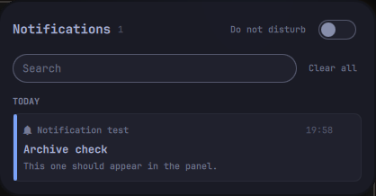

# Notifications

A notification center for the Omarchy bar: a bell, and a panel with every
notification you were sent over the last 30 days.



Omarchy shows a notification once and keeps the last ten. This keeps them all,
quietly, in the same style as the
[Displays](https://github.com/loneycoffee/omarchy-displays) panel:

- **Under the day it arrived**, newest first, each with its app's icon and the
  time. What came in since you last opened the panel has an accent bar, and the
  bell gets a dot.
- **A picture** when the notification was about one (a screenshot, a camera
  frame), read out of its click action.
- **Click** a card to open that picture, or to bring up the app that sent it.
  It never runs the command the notification arrived with: that command is
  chosen by whoever sent it, so a stored one would be a command waiting for a
  click. Only an absolute path to an image is kept, opened as an argument.
- **Right click** (or the × on hover) removes one; **Clear all** empties the
  panel. Neither comes back, even while Omarchy still has it in its last ten.
- **Search** across everything kept (`/` jumps to the field).
- **Do Not Disturb** in the header, the same switch as Omarchy's. Right click
  the bell to toggle it without opening anything.

The popups stay Omarchy's: this only reads what its notification service writes.

## Install

```bash
omarchy plugin add https://github.com/loneycoffee/omarchy-notifications.git --enable
```

Needs `inotifywait` (`inotify-tools`), which Omarchy already ships. To take over
from another notification center, disable it first, e.g.
`omarchy plugin disable jankeesvw.notification-center`; that one's history can be
brought over with `bin/notifs import-legacy`.

Open the panel from a keybinding with
`omarchy-shell shell toggle notification-center`.

## Where things are kept

`~/.local/state/omarchy/plugins/notification-center/`: one line of JSON per
notification, plus a copy of every icon and picture. The directory is `0700` and
the files `0600`. Only real images, of at most 5 MB, are copied, since their
paths come from the sender.

That is every notification you were sent, two-factor codes included. It never
leaves the machine, but it is not something to sync or back up carelessly.
Older than 30 days, or past the 1000 most recent, is deleted with its pictures.

## Command line

```
notifs sync            take new notifications from Omarchy's history, prune old
notifs list            JSON for the panel: entries newest first, and lastSeen
notifs seen            mark everything as read
notifs remove KEY      delete one notification
notifs clear           delete them all
notifs import-legacy   bring over what jankeesvw.notification-center kept
```

## License

MIT
